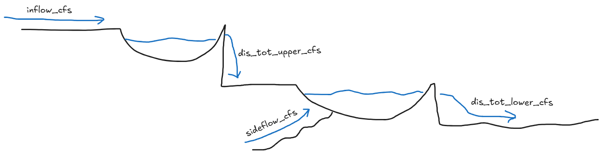

# Overview

This report explores inflow and outflow across 44 hydrologic simulation scenarios for a hypothetical two reservoir cascading hydro project. This report walks you through my thought process from initial data exploration and understanding to inflow-versus-outflow comparisons, ensemble median and percentile bands, and net-flow balance plots.

# Package Selection and Data Loading

Dplyr and tidyr are used for data wrangling and manipulation.
```{r}
library(dplyr)
library(tidyr)
```

ggplot2 and patchwork are used for plotting and combining plots.
```{r}
library(ggplot2)
library(patchwork)
```

Nanoparquet is used to read the parquet file.
```{r}
library(nanoparquet)

######################################
## Load inflow_outflow_dataset data ##
######################################

inflow_outflow_dataset <- read_parquet("inflow_outflow_dataset.parquet")
```

# Data Exploration and Understanding



## Reservoir inflow versus outflow scatter plots

```{r}
flow_summary <- inflow_outflow_dataset %>%
  mutate(lower_inflow_cfs = sideflow_cfs + dis_tot_upper_cfs) %>%
  select(inflow_cfs, dis_tot_upper_cfs, lower_inflow_cfs, dis_tot_lower_cfs) %>%
  pivot_longer(
    cols = everything(),
    names_to = "Flow",
    values_to = "cfs") %>%
  mutate(Flow = recode(Flow, inflow_cfs = "Upper Inflow", dis_tot_upper_cfs = "Upper Outflow", lower_inflow_cfs = "Lower Inflow", dis_tot_lower_cfs = "Lower Outflow")) %>%
  group_by(Flow) %>%
  summarise(
    Min = min(cfs, na.rm = TRUE),
    Max = max(cfs, na.rm = TRUE),
    Mean = mean(cfs, na.rm = TRUE),
    Median = median(cfs, na.rm = TRUE),
    .groups = "drop") %>%
  mutate(across(where(is.numeric), ~ round(.x, 2)))

flow_summary
```

```{r}
lower_reservoir_scatter_plot <- inflow_outflow_dataset %>%
  mutate(sum_lower_reservoir_inflow = sideflow_cfs + dis_tot_upper_cfs) %>%
  ggplot(., aes(x = sum_lower_reservoir_inflow, y = dis_tot_lower_cfs)) +
  geom_point(alpha = 0.5) +
  labs(title = "Lower Reservoir",
       y = "Outflow (cfs)") +
  theme_minimal() +
  xlab(element_blank())

upper_reservoir_scatter_plot <- inflow_outflow_dataset %>%
  ggplot(., aes(x = inflow_cfs, y = dis_tot_upper_cfs)) +
  geom_point(alpha = 0.5) +
  labs(title = "Upper Reservoir",
       x = "Inflow (cfs)",
       y = "Outflow (cfs)") +
  theme_minimal()

combined_plot <- lower_reservoir_scatter_plot / upper_reservoir_scatter_plot +
  plot_layout(heights = c(1, 1)) +
  plot_annotation(title = "Inflow vs Outflow")

combined_plot
```

An intial review of the inflow versus outflow scatter plots shows that the lower reservoir inflow and outflow follow a 1:1 relationship, while the upper reservoir inflow and outflow show a more complex relationship. From these intial scatter plots, I began to draw some hypotheses about how the upper and lower reservoirs might be operated particularly in terms of storage and operating rules.

## Initial Hypotheses

- **Upper Reservoir**
    - **Operating rules:** There is a clear horizontal line around the 15000 cfs mark with a few outliers above that mark and a most other points falling below that mark. This suggests that the upper reservoir may have a maximum outflow limit of around 15000 cfs, and that the operating rules may be designed to maintain outflows below this limit. Additionally, further exploration of the data shows days where upper reservoir outflow is 0 suggesting that there is no minimum outflow requirement for the upper reservoir.

    - **Storage Capacity:** Outflow and inflow are not a 1:1 relationship, indicating that the upper reservoir has the ability to store water.

- **Lower Reservoir**
    - **Operating rules:** The 1:1 relationship and the exact mean and median values for inflow and outflow suggest that the lower reservoir operates on a run of the river basis, with little regulation of outflows.

    - **Storage Capacity:** The run of the river hypothesis suggests that the lower reservoir has little to no storage capacity.


# Ensemble Analysis and Net FLow

## Upper reservoir
```{r}
####################################
## Upper Reservoir Ensemble Plots ##
####################################

upper_reservoir_ensemble_plot <- inflow_outflow_dataset %>%
  pivot_longer(cols = c(inflow_cfs, dis_tot_upper_cfs), names_to = "variable", values_to = "value") %>%
  mutate(variable = recode(variable, inflow_cfs = "Inflow", dis_tot_upper_cfs = "Outflow")) %>%
  group_by(dt, variable) %>%
  summarise(
    median_flow = median(value),
    p10 = quantile(value, 0.10),
    p25 = quantile(value, 0.25),
    p75 = quantile(value, 0.75),
    p90 = quantile(value, 0.90)) %>%
  ggplot(., aes(x = dt, color = variable, fill = variable)) +
  geom_ribbon(aes(ymin = p10, ymax = p90), alpha = 0.2,color = NA) +
  geom_ribbon(aes(ymin = p25, ymax = p75), alpha = 0.4,color = NA) +
  geom_line(aes(y = median_flow), linewidth = 0.75) +
  labs(title = "Ensemble Plot", y = "cfs") +
  xlab(element_blank()) +
  facet_wrap(~ c(variable)) + 
  theme(legend.position = "none")

upper_reservoir_netflow <- inflow_outflow_dataset %>%
  mutate(net_upper_reservoir = inflow_cfs - dis_tot_upper_cfs) %>%
  group_by(dt) %>%
  summarise(
    median_netflow = median(net_upper_reservoir),
    p10 = quantile(net_upper_reservoir, 0.10),
    p25 = quantile(net_upper_reservoir, 0.25),
    p75 = quantile(net_upper_reservoir, 0.75),
    p90 = quantile(net_upper_reservoir, 0.90)) %>%
  ggplot(., aes(x = dt)) +
  geom_ribbon(aes(ymin = p10, ymax = p90), alpha = 0.2,fill = "gray70") +
  geom_ribbon(aes(ymin = p25, ymax = p75), alpha = 0.4,fill = "gray50") +
  geom_ribbon(aes(ymin = pmin(median_netflow, 0), ymax = pmax(median_netflow, 0), fill = median_netflow >= 0), alpha = 0.5) +
  geom_line(aes(y = median_netflow), linewidth = 0.75) +
  scale_fill_manual(values = c("TRUE" = "#2f8a13","FALSE" = "#f32408")) +
  labs(title = "Net Flow", y = "cfs") +
  xlab(element_blank()) + 
  theme(legend.position = "none")

combined_plot <- upper_reservoir_ensemble_plot / upper_reservoir_netflow +
  plot_layout(heights = c(2, 1)) +
  plot_annotation(title = "Upper Reservoir Inflow vs. Outflow and Net Flow")

combined_plot
```

## Lower reservoir

```{r}
####################################
## Lower Reservoir Ensemble Plots ##
####################################

lower_reservoir_ensemble_plot <- inflow_outflow_dataset %>%
  mutate(sum_lower_reservoir_inflow = sideflow_cfs + dis_tot_upper_cfs) %>%
  pivot_longer(cols = c(sum_lower_reservoir_inflow, dis_tot_lower_cfs), names_to = "variable", values_to = "value") %>%
  mutate(variable = recode(variable, sum_lower_reservoir_inflow = "Inflow", dis_tot_lower_cfs = "Outflow")) %>%
  group_by(dt, variable) %>%
  summarise(
    median_flow = median(value),
    p10 = quantile(value, 0.10),
    p25 = quantile(value, 0.25),
    p75 = quantile(value, 0.75),
    p90 = quantile(value, 0.90)) %>%
  ggplot(., aes(x = dt, color = variable, fill = variable)) +
  geom_ribbon(aes(ymin = p10, ymax = p90), alpha = 0.2,color = NA) +
  geom_ribbon(aes(ymin = p25, ymax = p75), alpha = 0.4,color = NA) +
  geom_line(aes(y = median_flow), linewidth = 0.75) +
  labs(title = "Ensemble Plot", y = "cfs") +
  xlab(element_blank()) +
  facet_wrap(~ c(variable)) + 
  theme(legend.position = "none")

lower_reservoir_netflow <- inflow_outflow_dataset %>%
  mutate(sum_lower_reservoir_inflow = sideflow_cfs + dis_tot_upper_cfs) %>%
  mutate(net_lower_reservoir = sum_lower_reservoir_inflow - dis_tot_lower_cfs) %>%
  group_by(dt) %>%
  summarise(
    median_netflow = median(net_lower_reservoir),
    p10 = quantile(net_lower_reservoir, 0.10),
    p25 = quantile(net_lower_reservoir, 0.25),
    p75 = quantile(net_lower_reservoir, 0.75),
    p90 = quantile(net_lower_reservoir, 0.90)) %>%
  ggplot(., aes(x = dt)) +
  geom_ribbon(aes(ymin = p10, ymax = p90), alpha = 0.2,fill = "gray70") +
  geom_ribbon(aes(ymin = p25, ymax = p75), alpha = 0.4,fill = "gray50") +
  geom_ribbon(aes(ymin = pmin(median_netflow, 0), ymax = pmax(median_netflow, 0), fill = median_netflow >= 0), alpha = 0.5) +
  geom_line(aes(y = median_netflow), linewidth = 0.75) +
  scale_fill_manual(values = c("TRUE" = "#2f8a13","FALSE" = "#f32408")) +
  labs(title = "Net Flow", y = "cfs") +
  xlab(element_blank()) + 
  theme(legend.position = "none")

combined_plot <- lower_reservoir_ensemble_plot / lower_reservoir_netflow +
  plot_layout(heights = c(2, 1)) +
  plot_annotation(title = "Lower Reservoir Inflow vs. Outflow and Net Flow")

combined_plot
```

## Interpretation

- **Upper Reservoir:** The ensemble plots show that the upper reservoir has a maximum outflow limit of around 15000 cfs, with a few extreme scenarios exceeding this limit. The net flow plot shows that the upper reservoir has the ability to store and release water as conditions demand, with periods of both positive and negative net flow. Seasonal patterns are evident, with higher inflows during the spring and winter months, and lower inflows during the summer months. The net flow chart shows this seasonal pattern well as the net flow is positive during the spring and negative during the summer.

- **Lower Reservoir:** The ensemble plots show that the lower reservoir operates on a run of the river basis, with little regulation of outflows. The inflow and outflow maps are identical to one another. The net flow plot shows that the lower reservoir has little to no storage capacity, with net flow being close to zero throughout the year. Seasonal patterns are evident, with higher inflows during the spring and winter months, and lower inflows during the summer months.

# Findings and Discussion Points

- **Why median:** A median is a better representation of the central tendency of the data. In the initial discovery, it appeared that outliers were driving a higher mean value for upper river inflows and outflows. To aleviate this, chose to use the median or analysis.
- **Why ensemble analysis:** With 44 different hydrologic scenarios simulated over the same time period, an ensemble approach allowed me to evaluate the scenarios collectively rather than selecting a single simulation. Using medians and percentile ranges, I could identify typical flow patterns while also showing the variability across scenarios. Without additional historical observations or explanatory variables beyond inflow and outflow, developing a reliable predictive forecasting model was not a reasonable approach.
- **Inflow decisions:** The upper reservoir uses `inflow_cfs` as the inflow; the lower reservoir uses `sideflow_cfs + dis_tot_upper_cfs` as the inflow.
- **Seasonal patterns:** Both reservoirs show seasonal patterns in inflow and outflow, with higher flows during winter and spring and lower flows during summer. This is likely influenced by regional precipitation and snowmelt patterns. Looking at the upper reservoir's net flow, the reservoir experienced positive net flow from approximately April through July, suggesting that inflows exceeded outflows and water was being stored. From July through September, net flow became negative, suggesting the reservoir was drawing down stored water. One possible explanation is that the reservoir stores water during periods of higher runoff and releases it during summer to support hydropower generation when electricity demand may increase due to cooling needs. Moving into fall and winter, net flow remained slightly negative but approached zero. This could reflect increasing inflows from seasonal precipitation alongside continued hydropower generation to meet electricity demand, potentially shifting from cooling to heating needs. While these patterns are consistent with seasonal reservoir operations, additional information about storage levels, generation schedules, and electricity demand would be needed to confirm these relationships.


